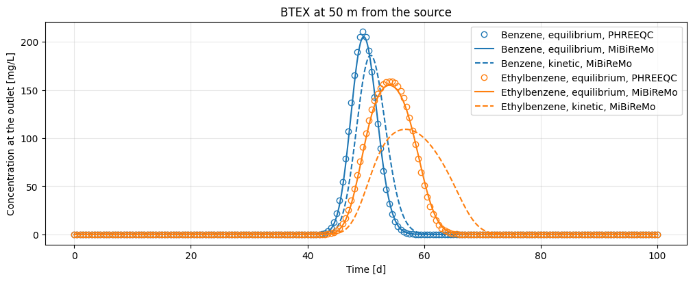

# Column model

`mibiremo.ColumnModel` simulates a laboratory column experiment, in which a soil sample is flushed with an aqueous solution. It can also be used to represent one-dimensional reactive-transport processes in an aquifer.
Advection and dispersion of all aqueous components are simulated using the semi-Lagrangian solver (`SemiLagSolver`), while geochemical reactions are computed with PHREEQC through PhreeqcRM. Transport and reactions are coupled sequentially at each time step using a sequential non-iterative approach (SNIA).

The inputs are consistent with the conventions adopted in the [field](field_model.md) and [batch](batch_model.md) models, allowing the same PHREEQC solutions and kinetic definitions to be used across all three models. Equilibrium phases are also defined in the same way as in the batch model.

## Examples
- [laboratory column test](notebooks/column_reactive_transport_test.ipynb),
- [BTEX dissolution and transport](notebooks/column_BTEX_dissolution.ipynb), and
- [column validation against mibitrans](notebooks/validation_column_vs_mibitrans.ipynb).


/// figure-caption
Dissolved concentrations of benzene and ethylbenzene in a column model over a simulation period of 100 days.
///

## Workflow

```python
import math
import mibiremo as mb

minute, hour = 60.0, 3600.0
flow_rate = 1e-6 / minute  # 1 mL/min in m3/s

model = mb.ColumnModel(
    workspace="output/column",
    length=0.3,                                    # L [m]
    diameter=0.05,                                 # [m]
    porosity=0.38,
    flow_rate=[(0.0, flow_rate), (10 * hour, 0.0), (16 * hour, flow_rate)],  # Q [m3 s-1], stopped for 6 h
    longitudinal_dispersivity=0.005,               # alpha_L [m]
    n_cells=60,
    simulation_time=30 * hour,
    time_step=5 * minute,
    database="my_database.dat",                    # kinetic rates in its RATES block
    solutions={1: pore_water, 2: influent},        # {component: mol/kgw, "pH": ..., "pe": ...}
    initial_solution=1,
    influent_solution=2,                           # solution number, constant or time-dependent
    equilibrium_phases={1: {"Calcite": [0, 0.1]}}, # PHREEQC EQUILIBRIUM_PHASES blocks (optional)
    initial_equilibrium_phases=1,                  # block number, for all cells or one per cell (-1 for none)
    kinetics={1: reaction},                        # PHREEQC KINETICS blocks
    initial_kinetics=1,                            # KINETICS block number, for all cells or one per cell
)
model.run()
breakthrough = model.effluent("Tr")                # DataFrame: time [s], pore_volumes, concentration
profile = model.concentration("Tr", 2 * hour)      # array, one value per cell at model.x
```

## Conventions

- **Units**: SI throughout: m, s, m³ s⁻¹. Concentrations in mol m⁻³ (= mmol L⁻¹); the PHREEQC solutions are given in
  mol kgw⁻¹, and the KINETICS amounts `m0` in moles per litre of water, as in the field model. The EQUILIBRIUM_PHASES
  amounts are also in moles per litre of water.
- **Time-dependent inputs**: the flow rate, the influent solution, and the time step are constants or lists
  `[(t, value), ...]` starting at $t = 0$, each value holding until the next $t$. Stress periods start at every change
  time (`model.stress_periods`). A flow rate of 0 stops the flow (stop-flow tests); diffusion continues.
- **Grid**: the column is divided into `n_cells` cells of length $\Delta x = L / n_\text{cells}$. The concentration of
  each cell is computed at its downstream end, $x_i = i \Delta x$ with $i = 1, \dots, n_\text{cells}$ (`model.x`), so
  the last cell, $x = L$, gives the effluent. A cell range, e.g. `model.x <= 0.1` for the first 10 cm, sets `initial_solution` or `initial_kinetics` per
  cell.

## Model

Flow is one-dimensional, with the average linear velocity $v$ [m s⁻¹] and the longitudinal dispersion coefficient
$D_L$ [m² s⁻¹]:

$$
v = \frac{Q}{n A}, \qquad A = \frac{\pi d^2}{4}, \qquad D_L = \alpha_L v + D^*
$$

where $Q$ is the flow rate, $n$ the porosity, $d$ the column diameter, $\alpha_L$ the longitudinal dispersivity, and
$D^*$ the effective molecular diffusion coefficient. Each aqueous component $C$ is transported according to the
advection–dispersion equation

$$
\frac{\partial C}{\partial t} + v \frac{\partial C}{\partial x} = D_L \frac{\partial^2 C}{\partial x^2},
\qquad C(0, t) = C_\text{in}(t), \qquad \left. \frac{\partial C}{\partial x} \right|_{x = L} = 0
$$

- The influent enters at $x = 0$ with a fixed concentration $C_\text{in}$ (first-type boundary); the outlet has a zero
  concentration gradient.
- Transport: advection along the characteristics with monotone cubic interpolation, then dispersion with the Saul'yev
  alternating-direction scheme; both are stable for any time step, the accuracy needs Courant numbers
  $v \Delta t / \Delta x$ of about 1 or less.
- Every component of the solutions is transported, including H, O, and the charge balance; immobile reactants must be
  KINETICS reactants.
- `model.phreeqc` is the `mibiremo.PhreeqcRM` object after `run`, and `model.components` the transported components.
  The workspace holds the PHREEQC input (`column.pqi`) and the PhreeqcRM output files.

## Results

- `effluent(component)`: concentration of the last cell at every time step, with the time and the pore volumes
  flushed $V / V_p$, where $V_p = n A L$ (`model.pore_volume`).
- `concentration(component, time)`: concentration profile at the end of the time step containing `time`.
- `kinetic_reactant(reactant)`: amount of a KINETICS reactant, e.g. an immobile contaminant, in every cell at every
  time step (DataFrame: index time [s], one column per cell), in moles per litre of water as `m0`.

## Verification

The column model is verified against the exact analytical solution of
[mibitrans](https://github.com/MiBiPreT/mibitrans) (one-dimensional limit, constant influent concentration, no
transverse dispersion), for a conservative component and for one with first-order decay
([column validation against mibitrans](notebooks/validation_column_vs_mibitrans.ipynb)).
