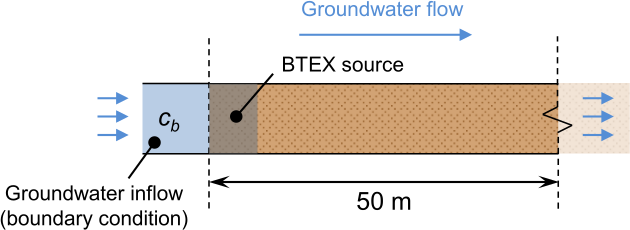
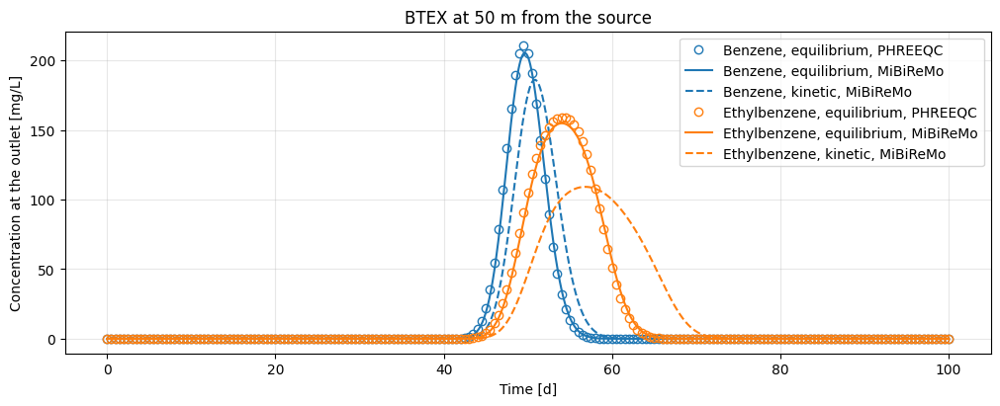
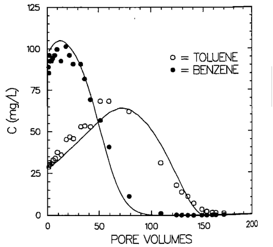

# MiBiReMo - Examples

Eight examples are available as both Python scripts and Jupyter notebooks.
To run the examples as scripts, navigate to the `examples` directory and run the desired example:
```sh
cd examples
python column_reactive_transport_test.py
```

Interactive Jupyter notebooks are also available in the `examples` folder, and can be viewed in the [Tutorial Notebooks](notebooks/column_reactive_transport_test.ipynb) section.

The field model examples and `validation_field_vs_mibitrans.py` need MODFLOW 6 and its shared library (`get-modflow :python --subset mf6,libmf6`).

## Field model
These examples use `FieldModel`. See [Field model](field_model.md) for the conventions of the model.

### Tracer test
The example `field_tracer_test.py` builds a MODFLOW 6 model of an in situ biological flushing installation with `FieldModel`: one extraction well and four injection wells around it in a confined aquifer with groundwater flow. A tracer is injected during the first day. The example shows the hydraulic head and drawdown, the tracer plume, and the breakthrough and recovery at the extraction well.

### Injection-extraction distance
The example `field_injection_extraction_distance.py` repeats the tracer test of `field_tracer_test.py` with the injection wells at 4 m, 6 m, and 10 m from the extraction well, and compares the breakthrough curves and the tracer mass recovery at the extraction well.

### Layered aquifer
The example `field_layered_model.py` repeats the tracer test of `field_tracer_test.py` in a layered aquifer made of three hydrostratigraphic units, with a sloping top and a general-head boundary, and compares it with a homogeneous single-layer aquifer of the same transmissivity. The example shows the hydrostratigraphic units and the tracer in cross sections, and the breakthrough at the extraction well and at a monitoring well with two sampling levels.

## Column model
These examples use `ColumnModel`. See [Column model](column_model.md) for the conventions of the model.

### Laboratory column test
The example `column_reactive_transport_test.py` simulates a laboratory column with `ColumnModel`: a soil column flushed with a solution containing a conservative tracer and a solute degraded with first-order kinetics, with a flow interruption (stop-flow test). The example shows the breakthrough curves in time and in pore volumes flushed, and the concentration profiles in the column.

### BTEX dissolution and transport
The `column_BTEX_dissolution.py` example uses `ColumnModel` to simulate the dissolution of a benzene–ethylbenzene non-aqueous phase liquid (NAPL) in a porous medium. The 50 m-long column represents a one-dimensional groundwater flow path in the aquifer:



Initially, the column contains non-contaminated groundwater, with an immobile NAPL source located in the first 0.5 m. The source contains 0.03 mol of each constituent per litre of water. Groundwater flows through the column at an average velocity of 1 m/d, and benzene and ethylbenzene concentrations are monitored at the outlet, 50 m downstream of the source, over a 100-day period.

Three simulations are compared:
1. **Equilibrium dissolution with standalone PHREEQC**: simulated using the `TRANSPORT` keyword (input file: `pqi/column_BTEX_dissolution.pqi`).
2. **Equilibrium dissolution with `ColumnModel`**: each NAPL constituent is represented as a pure phase using PHREEQC's `EQUILIBRIUM_PHASES` keyword.
3. **Kinetic dissolution with `ColumnModel`**: the dissolution rate is proportional to the difference between the effective solubility, calculated using Raoult's law, and the aqueous concentration, as implemented through PHREEQC's `KINETICS` keyword.





Benzene, being more soluble, is depleted from the NAPL first and reaches the column outlet earlier than ethylbenzene. This behaviour is consistent with the experimental results of Geller and Hunt (1993) [[1]](#1), who injected an equimolar mixture of benzene and toluene into the centre of a column and subsequently flushed it with water. Benzene was eluted first, followed by toluene, reflecting their different solubilities.



## Batch model
This example uses `BatchModel`. See [Batch model](batch_model.md) for the conventions of the model.

### Aerobic biodegradation in mesocosms
The example `batch_first_order_decay.py` simulates an aerated soil mesocosm with `BatchModel`: residual petroleum hydrocarbons (TPH) degraded aerobically with a first-order rate limited by the dissolved O₂ (Monod term), with the pore water kept in equilibrium with air. The example shows the TPH content in time, compared with the analytical solution of the first-order model, c0 exp(-k F t).

## Numerical validation
These examples compare the models with the exact analytical solution of [mibitrans](https://github.com/MiBiPreT/mibitrans) (Wexler, 1992) [[2]](#2), for a conservative tracer and for a solute with first-order decay (a PHREEQC KINETICS reactant).

### Column model vs mibitrans
The example `validation_column_vs_mibitrans.py` validates `ColumnModel` against the analytical solution in its one-dimensional limit: the column of `column_reactive_transport_test.py`, flushed with a constant influent concentration. The example compares the concentration profiles in the column and the breakthrough curves at the outlet.

### Field model vs mibitrans
The example `validation_field_vs_mibitrans.py` validates the transport and the PHREEQC coupling of `FieldModel(phreeqc_coupling=True)`, which couples MODFLOW 6 and PHREEQC through mf6rtm. The plume from a constant-concentration source in uniform flow is compared with the analytical solution.


## References

<a id="1">[1]</a> Geller, J. T., and J. R. Hunt (1993), Mass transfer from nonaqueous phase organic liquids in water-saturated porous media, Water Resour. Res., 29(4), 833–845, doi:[10.1029/92WR02581](https://doi.org/10.1029/92WR02581).

<a id="2">[2]</a> Wexler, E. J. (1992), Analytical solutions for one-, two-, and three-dimensional solute transport in ground-water systems with uniform flow, U.S. Geological Survey Techniques of Water-Resources Investigations, Book 3, Chapter B7, doi:[10.3133/twri03B7](https://doi.org/10.3133/twri03B7).
