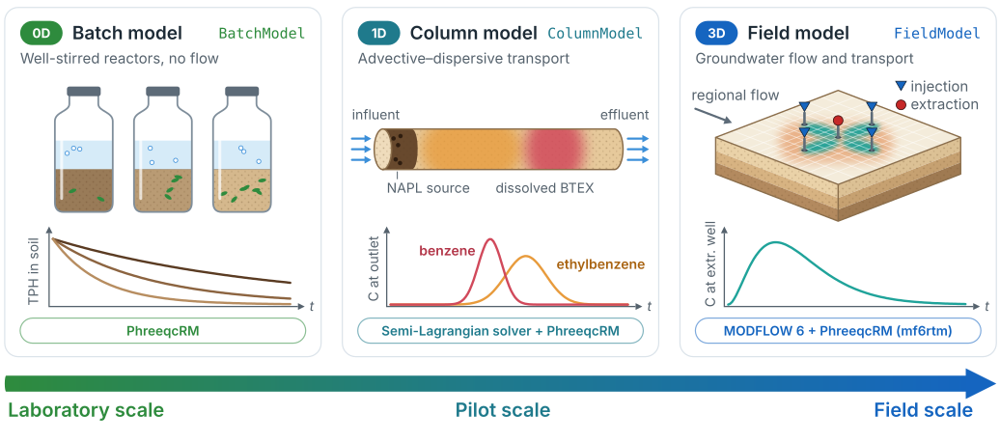
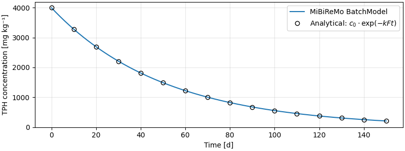
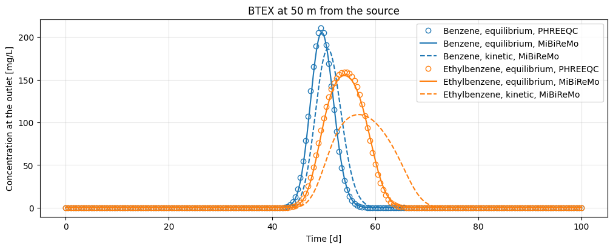
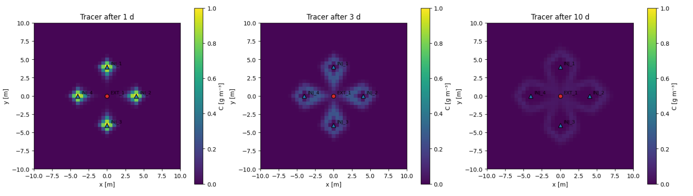

# Documentation for `mibiremo` python package

## General

MiBiReMo (Microbiome Bioremediation Reactive-transport Module) is an open-source Python package for the simulation and design of soil and groundwater bioremediation systems. It provides a framework for implementing reactive-transport models at both laboratory and field scales. The package comprises three modelling components that use PHREEQC to simulate biological and biogeochemical reactions:

- **[Batch model](batch_model.md)**: simulates biogeochemical reactions in well-mixed systems under static conditions, without flow.
- **[Column model](column_model.md)**: simulates one-dimensional advective–dispersive transport coupled with biogeochemical reactions.
- **[Field model](field_model.md)**: simulates three-dimensional groundwater flow and solute transport using MODFLOW 6, coupled with PHREEQC through [mf6rtm](https://github.com/p-ortega/mf6rtm). It is primarily intended for modelling in-situ biological flushing systems based on injection and extraction wells.

/// figure-caption
The three modelling components of MiBiReMo, which allow reactive-transport simulations from laboratory to field scale.
///

/// figure-caption
Total petroleum hydrocarbon (TPH) concentration in an aerated soil mesocosm simulated with the batch model, compared with the analytical first-order solution.
///

/// figure-caption
Dissolved concentrations of benzene and ethylbenzene in a column model over a simulation period of 100 days.
///

/// figure-caption
Tracer concentration at three different time points in a field model of a biological flushing installation with one extraction well and four injection wells.
///

## Documentation

- [Introduction](index.md): overview of the package and of the MIBIREM project and getting started.
- [Models](batch_model.md): model description, workflow, and conventions.
- [How to](examples.md): description of the examples, which are also available as tutorial notebooks.
- [Contributing](CONTRIBUTING.md): description of the examples, which are also available as tutorial notebooks.
- [API reference](reference/models.md): classes and functions of the package.

## MIBIREM project

MiBiReMo is part of the MiBiPreT (Micro-Bioremediation Prediction Tool) suite, developed within the MIBIREM bioremediation toolbox.

[MIBIREM – Innovative Technological Toolbox for Bioremediation](https://www.mibirem.eu/) is an EU-funded research project involving a consortium of 12 partners from across Europe, with the aim of developing an integrated technological toolbox for bioremediation. The project focuses on the development of molecular methods for the monitoring, isolation, cultivation, and subsequent application of microbiomes. It also investigates approaches to enhance specific microbiome functions through processes such as microbial evolution and enrichment. The performance of selected microbiomes is subsequently evaluated under field conditions. The `mibiremo` Python package is one of the technological components developed within this toolbox.

**Next: [Getting Started](getting_started.md)**
